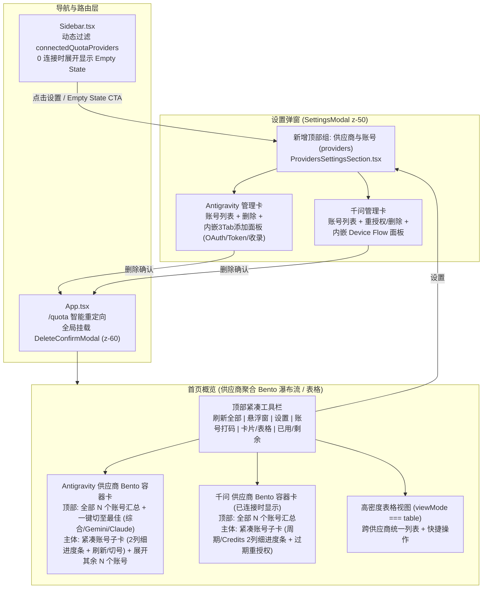

# Graviton 首页供应商聚合 Bento Grid、账号管理迁入设置与动态额度子菜单实施计划

## 目标概述

本次改造为纯前端架构与界面升级（无需改动 Go 后端与 `frontend/wailsjs/` 绑定），围绕三个核心目标展开：

1. **首页「概览」重构为高密度、按供应商聚合的瀑布流 Bento Grid**：
   - 视觉与信息密度对标专业多供应商额度监控面板：**每个已连接供应商占一张 Bento 容器卡**，多账号时顶部自带「全部 N 个账号」聚合汇总区，下方紧凑堆叠各账号子卡并支持「展开其余 N 个账号 / 收起」。
   - 账号子卡内采用 **2 列高密度紧凑指标网格** + **纤细连续进度条** + **重置时间微文案**，最大化一屏可读信息量。
   - 顶部集成精简工具栏：**刷新全部**、**桌面悬浮窗**、**设置**、**账号打码（隐私脱敏）**、**卡片 / 表格视图切换**、**已用 / 剩余数值模式切换**。
   - 在 Antigravity 供应商卡（以及表格视图顶栏）内建 **「一键切换到额度最多的 Antigravity 账号」**（支持按 `综合 / Gemini / Claude` 维度切换），同时非当前 Antigravity 账号子卡也支持直接一键切号。
   - **仅展示已连接的供应商**：与侧边栏保持一致，未连接的供应商不占位；顶部工具栏与空状态保留直达「设置 → 供应商与账号」入口。
2. **「添加账号」与供应商连接逻辑统一迁入「设置」**：
   - 在 `SettingsModal` 顶部新增独立分组 **「供应商与账号」(`providers`)**，并纳入设置搜索索引（`settingsRegistry.ts`）。
   - Antigravity 与千问各占一张供应商管理卡片，支持**完整生命周期管理**：查看已连接账号列表、内嵌展开添加/授权表单（无嵌套弹窗冲突）、过期一键重新授权、以及移除账号（复用全局删除确认弹窗）。
   - 彻底移除 `QuotaPage` 与 `QianwenQuotaPage` 顶部的「添加账号 / 连接千问账号」按钮和对应独立弹窗组件（`AddAccountModal.tsx`、`QianwenConnectModal.tsx`），让额度页专注监控与切号。
3. **侧边栏「额度」子菜单动态显示已连接供应商**：
   - 仅当某供应商已连接账号数 `> 0` 时，才在侧边栏「额度」下显示该供应商子菜单项（例如仅连接 Antigravity 时只显示 Antigravity，不显示千问）。
   - 当未连接任何供应商时，侧边栏仍保留「额度」菜单项，展开后展示紧凑的 Empty State（引导前往「设置 → 供应商与账号」）。
   - 当删除某供应商的最后一个账号导致当前所在额度页清空时，自动跳转至另一个已连接供应商页或「概览」页（并妥善处理初始异步加载与设置弹窗打开时的路由竞态）。

---

## 架构与数据流总览



---

## 关键设计与边界约束

> [!IMPORTANT]
> **执行时必须避免的 5 个核心陷阱**
> 1. **初始加载竞态（误重定向）**：应用启动时 `useAccountStore.loadAccounts()` 与 `useQianwenStore.loadAccounts()` 是异步 IPC，初始 `accounts` 为空数组。必须在两个 store 中新增 `hasLoaded: boolean` 标志，只有 `hasLoaded === true` 时才执行空供应商自动重定向。
> 2. **在设置弹窗内删光当前背景页供应商的最后一个账号**：当 `SettingsModal` 处于打开状态（URL 为 `/settings/providers`，背景页为 `/quota/qianwen`）时，如果背景挂载的 `QianwenQuotaPage` 直接调用 `navigate('/overview')` 会意外关闭设置弹窗。解决方式：额度页自动重定向仅在 `!isSettingsPath(location.pathname)` 时触发；同时 `SettingsModal.handleClose()` 与 `App.tsx` 的 `Ctrl+,` 关闭逻辑在关闭设置时检查目标 `backgroundLocation` 是否为已清空的供应商路径，若是则直接回退到有效目标路由。
> 3. **删除确认弹窗与设置弹窗的层级及交互冲突**：`DeleteConfirmModal` 和 `QianwenDeleteConfirmModal` 原先各自挂载在 `QuotaPage` / `QianwenQuotaPage` 且使用 `z-50`。必须将其提升至 `App.tsx` 的 `AppShell` 中（紧跟 `<SettingsModal />` 之后），并将 overlay/content 层级统一升至 `z-[60]`（与 `ChangelogModal`、`UpdateModal` 保持一致），同时在 `SettingsModal` 的 `onPointerDownOutside` / `onInteractOutside` 中增加 `hasOtherDialogOpen(true)` 防护。
> 4. **内嵌授权面板的后台会话清理**：从弹窗改为内嵌展开面板后，当面板收起、`SettingsModal` 关闭、切换到其他设置分组、或组件卸载时，如果存在进行中的 Antigravity OAuth 会话或千问 Device Flow 会话，必须主动调用 `api.cancelOAuthLogin()` / `api.cancelQianwenAuth()`，并清理 `EventsOn` 订阅与倒计时定时器。
> 5. **「已用 / 剩余」模式下的颜色语义与单供应商宽度自适应**：
>    - 切换到「已用」模式时，进度条**填充长度**显示 `usedPct = 100 - remainingPct`，文案显示 `已用 X%`，但**健康告警颜色仍由 `remainingPct` 决定**（剩余 `<=15%` 即已用 `>=85%` 为玫瑰红，剩余 `<=50%` 为琥珀黄，其余为翠绿），切勿把“已用 10%”误染成红色告警！
>    - 瀑布流列数必须按**实际已连接供应商数量**自适应：1 个供应商时容器撑满宽度且内部账号子卡自动 2 列排布（避免左侧单列 1/3 宽、右侧 2/3 大片留白）；2 个供应商时 2 列等宽瀑布流；未来 3+ 供应商时自动升级为 3 列瀑布流。

---

## 详细变更清单

按依赖顺序分组，建议严格按以下 4 个阶段依次实施：

### 阶段 1：工具层与 Store 基础设施

#### [MODIFY] `frontend/src/utils/quota.ts`
新增三组纯函数，供首页高密度 Bento 面板复用：

1. **「额度最多 Antigravity 账号」判定与聚合计算**：
   ```ts
   export type BestAccountDimension = 'overall' | 'gemini' | 'claude';

   export interface BestAccountCandidate {
     account: AccountDisplay;
     score: number;       // 0-100, 当前维度得分
     minGroupPct: number; // 0-100 或 -1, 用于平局比较
   }

   export interface BestAccountSelection {
     currentScore: number; // 无当前账号/受限/未知时为 -1
     bestSwitchCandidate: BestAccountCandidate | null;
     isCurrentAlreadyBest: boolean;
   }

   export interface ProviderGroupAggregate {
     name: string;
     avgRemainingPct: number; // 0-100 或 -1
     validAccountCount: number;
   }
   ```
   - `getAccountGroupScores(account: AccountDisplay): number[]`：遍历 `account.groups || []`，每个含非空 `buckets` 的 group 取 `Math.min(...group.buckets.map((b) => Math.round(b.remainingFraction * 100)))`。
   - `getAccountOverallScore(account: AccountDisplay): { avg: number; min: number }`：有分组得分时取均值 `avg` 与最小值 `min`；否则回退 `account.remainingPercentage`。
   - `getAccountDimensionScore(account: AccountDisplay, dimension: BestAccountDimension): number`：`'overall'` 取 `avg`，`'gemini'` / `'claude'` 调用 `getGroupEffectivePct`。
   - `pickBestAntigravityAccount(accounts: AccountDisplay[], dimension: BestAccountDimension): BestAccountSelection`：
     - 排除 `acc.isForbidden` 及 `score < 0` 的账号。
     - 从**非当前账号 (`!acc.isCurrent`)** 中按优先级降序挑选 `bestSwitchCandidate`：① 当前维度 `score` 更高 → ② `overall.avg` 更高 → ③ `overall.min`（短板）更高 → ④ 订阅等级更高（`ULTRA (4) > ENTERPRISE (3) > PRO (2) > FREE (1)`）。
     - 计算当前账号 `currentScore`，当存在当前账号、未受限、`currentScore >= 0` 且无严格更优候选账号时，`isCurrentAlreadyBest = true`。
   - `aggregateAntigravityGroups(accounts: AccountDisplay[]): ProviderGroupAggregate[]`：按 `group.displayName` 汇总所有未受限账号的各模型组平均有效剩余百分比，供 Antigravity 容器卡顶部「全部 N 个账号」汇总区渲染 2 列聚合进度条。

2. **账号隐私打码函数**：
   ```ts
   export function maskAccountIdentity(value?: string): string
   ```
   - 邮箱（含 `@`）：保留前缀前 2~3 位 + `***` + `@域名`（如 `xiaohai@gmail.com` → `xia***@gmail.com`，短前缀 `ab@x.com` → `a***@x.com`）。
   - 非邮箱（手机号 / 昵称 / ID）：长度 `> 5` 时保留前 3 位 + `****` + 后 2 位（如 `17312345681` → `173****81`）；长度 `2~5` 时保留首尾或首字 + `***`；空串返回 `***`。

3. **「已用 / 剩余」模式格式化函数**：
   ```ts
   export type QuotaDisplayMode = 'remaining' | 'used';

   export interface FormattedQuotaMetric {
     remainingPct: number; // 0-100 或 -1（决定颜色语义）
     barPct: number;       // 0-100 或 -1（决定进度条宽度：remaining 模式为 remainingPct，used 模式为 100 - remainingPct）
     label: string;        // 如 "剩余 85%" / "已用 15%" / "未知"
     shortValue: string;   // 如 "85%" / "15%" / "未知"
   }

   export function formatQuotaByMode(remainingPct: number, mode: QuotaDisplayMode): FormattedQuotaMetric
   ```

---

#### [MODIFY] `frontend/src/store/useAccountStore.ts`
- 在 `AccountState` 中新增 `hasLoaded: boolean`（初始值 `false`）。
- 在 `loadAccounts` 的 `try` 和 `catch` 分支更新状态时均设置 `hasLoaded: true`。

#### [MODIFY] `frontend/src/store/useQianwenStore.ts`
- 在 `QianwenState` 中新增 `hasLoaded: boolean`（初始值 `false`）。
- 在 `loadAccounts` 的 `try` 和 `catch` 分支更新状态时均设置 `hasLoaded: true`。

---

#### [NEW] `frontend/src/store/useOverviewPrefsStore.ts`
持久化首页概览工具栏偏好设置（存入 `localStorage` 键 `graviton_overview_prefs`，异常静默回退默认值）：
```ts
export type OverviewViewMode = 'card' | 'table';

interface OverviewPrefsState {
  viewMode: OverviewViewMode;           // 默认 'card'
  quotaDisplayMode: QuotaDisplayMode;   // 默认 'remaining'
  maskAccount: boolean;                 // 默认 false
  bestDimension: BestAccountDimension;  // 默认 'overall'
  setViewMode: (mode: OverviewViewMode) => void;
  setQuotaDisplayMode: (mode: QuotaDisplayMode) => void;
  toggleMaskAccount: () => void;
  setBestDimension: (dim: BestAccountDimension) => void;
}
```

---

#### [MODIFY] `frontend/src/store/useSettingsModalStore.ts`
1. 扩展 `SettingsSectionId`：
   ```ts
   export type SettingsSectionId = 'providers' | 'general' | 'environment' | 'ai' | 'about';
   ```
   - `CANONICAL_SECTIONS` 加入 `'providers'`。
   - `DEFAULT_SETTINGS_SECTION` 保持 `'general'`（`Ctrl+,` 与底部「设置」按钮行为不变；添加/连接/重新授权与概览工具栏「设置」入口显式指向 `/settings/providers`）。
   - `SETTINGS_SECTION_ALIASES` 新增：`accounts`、`account`、`provider`、`antigravity`、`qianwen` → `'providers'`。
2. 新增一次性跳转意图：
   ```ts
   export interface ProviderSettingsIntent {
     provider: 'antigravity' | 'qianwen';
     action: 'add' | 'reauth';
     antigravityTab?: 'oauth' | 'token' | 'capture';
     qianwenAccountId?: string;
   }
   ```
   在 `useSettingsModalStore` 中增加 `pendingProviderIntent`、`setPendingProviderIntent`、`consumePendingProviderIntent`。
3. 导出统一导航与安全回退辅助函数：
   - `openSettingsModal(navigate, location, section, providerIntent?)`
   - `resolveSafeQuotaFallback(agCount: number, qwCount: number): string`（`agCount > 0 ? '/quota/antigravity' : qwCount > 0 ? '/quota/qianwen' : '/overview'`）
   - `isEmptyQuotaPath(pathname: string, agCount: number, agLoaded: boolean, qwCount: number, qwLoaded: boolean): boolean`

---

### 阶段 2：设置中心新增「供应商与账号」分组

#### [MODIFY] `frontend/src/components/settings/settingsRegistry.ts`
1. 导入 `Users`（来自 `lucide-react`）。
2. 在 `SETTINGS_SECTIONS` **索引 0（最顶部）** 新增：
   ```ts
   {
     id: 'providers',
     label: '供应商与账号',
     title: '供应商与账号',
     subtitle: '连接或管理 Antigravity 与千问账号，连接后自动出现在左侧「额度」菜单与首页概览中',
     icon: Users,
   }
   ```
3. 同步更新 `SETTINGS_SECTION_MAP`（按 `id` 显式映射，避免数组下标偏移错误）。
4. 在 `SETTINGS_SEARCH_ENTRIES` 顶部新增 2 条可搜索项：
   - `id: 'provider-antigravity'`，`section: 'providers'`，`title: 'Antigravity 账号管理'`，`keywords: ['antigravity', 'google', 'oauth', 'token', 'refresh token', 'capture', '添加账号', '收录', '导入', '供应商', '账号']`
   - `id: 'provider-qianwen'`，`section: 'providers'`，`title: '千问账号连接'`，`keywords: ['qianwen', 'qwen', '千问', '通义', 'token plan', 'device flow', 'oauth', '连接', '重新授权', '供应商', '账号']`

---

#### [NEW] `frontend/src/components/settings/ProvidersSettingsSection.tsx`
将原 `AddAccountModal.tsx` 与 `QianwenConnectModal.tsx` 的完整业务逻辑重构为两个内嵌式供应商管理卡片，Props：
```ts
interface ProvidersSettingsSectionProps {
  entryHighlightClass: (id: string) => string;
  onNavigateToQuota: (path: string) => void;
}
```

**详细交互与状态规格**：
- **卡片 1：Antigravity**（`data-settings-entry-id="provider-antigravity"`）：
  - **头部**：品牌标识 + `Antigravity` + 状态徽章（`已连接 N 个账号` / `未连接`）；右侧：已连接时显示「查看额度」次级按钮（调 `onNavigateToQuota('/quota/antigravity')`），主按钮「添加账号 / 收起」切换 `agAddOpen`。
  - **内嵌展开添加面板 (`AnimatePresence`)**：
    - 完整保留原 `AddAccountModal.tsx` 的 3 个 Tab：`OAuth 登录`、`导入 Token`、`收录当前账号`（`motion` pill 动画 `settings-ag-add-tab-pill`）。
    - `OAuth 登录`：调用 `api.startOAuthLogin()`、`api.cancelOAuthLogin()`、`api.completeOAuthWithCallbackURL()`，监听 `EventsOn('oauth:completed', ...)`；支持复制授权链接、手动粘贴回调 URL；成功后刷新账号、弹成功 Banner 并自动收起面板。
    - `导入 Token`：调用 `api.importRefreshTokens(tokenInput)` 并展示逐条导入结果。
    - `收录当前账号`：调用 `useAccountStore.captureCurrentAccount()`，成功后自动收起面板。
    - **会话清理**：使用 `oauthSessionRef` 跟踪活跃会话；当 `agAddOpen` 关闭或组件卸载时，主动调用 `void api.cancelOAuthLogin().catch(() => {})` 并解除 `EventsOn('oauth:completed')`。
  - **已连接账号列表**（`agAccounts.length > 0` 时展示）：
    - 紧凑列表行：邮箱、`subscriptionTier` 徽章、`使用中` 绿色标记、`isForbidden` 警告标记、上次刷新相对时间、右侧「删除」图标按钮（调用 `useAccountStore.confirmDeleteAccount(acc)`）。
- **卡片 2：千问 · Token Plan**（`data-settings-entry-id="provider-qianwen"`）：
  - **头部**：靛蓝色标识 + `千问 · Token Plan` + 状态徽章（`已连接 N 个账号` / `未连接`）；右侧：已连接时显示「查看额度」次级按钮（调 `onNavigateToQuota('/quota/qianwen')`），主按钮「连接千问账号 / 收起」切换 `qwConnectOpen`（新连接时清空 `qwReauthTarget`）。
  - **内嵌展开 OAuth Device Flow 面板 (`AnimatePresence`)**：
    - 完整迁移原 `QianwenConnectModal.tsx` 逻辑：支持 `qwReauthTarget`（展示目标账号名，传 `qwReauthTarget.id` 给 `api.startQianwenAuth`）、轮询状态文案、剩余时间倒计时、`BrowserOpenURL(session.verificationUrl)`、复制链接/设备码、取消等待。
    - 授权成功后刷新 `useQianwenStore.loadAccounts()`、弹成功 Banner、重置状态并自动收起面板。
    - **会话清理**：使用 `qwSessionRef` 跟踪活跃会话；当 `qwConnectOpen` 关闭、切换 `qwReauthTarget`、或组件卸载时，主动调用 `void api.cancelQianwenAuth().catch(() => {})`，清理 `setInterval` 与 `EventsOn('qianwen:auth')`。
  - **已连接账号列表**（`qwAccounts.length > 0` 时展示）：
    - 紧凑列表行：显示名 (`name || email || aliyunId`)、套餐标签（个人版/团队版/未订阅）、若 `quota?.authExpired` 显示琥珀色「授权已过期」标记与「重新授权」按钮（点击展开内嵌面板并设定 `qwReauthTarget = acc`）、右侧「移除」图标按钮（调用 `useQianwenStore.confirmDeleteAccount(acc)`）。
- **意图消费 (`useEffect`)**：
  - 监听 `pendingProviderIntent` 并调用 `consumePendingProviderIntent()`：
    - `provider === 'antigravity'`：展开 `agAddOpen = true`，若传入 `antigravityTab` 则切到对应 Tab，并滚动到 `provider-antigravity`。
    - `provider === 'qianwen'`：若 `action === 'reauth'` 且有 `qianwenAccountId`，匹配对应账号设为 `qwReauthTarget`；展开 `qwConnectOpen = true`，并滚动到 `provider-qianwen`。

---

#### [MODIFY] `frontend/src/components/settings/SettingsModal.tsx`
1. 当 `activeSection === 'providers'` 时渲染 `<ProvidersSettingsSection />`，传入 `entryHighlightClass` 与 `onNavigateToQuota={(path) => navigate(path, { replace: true })}`。
2. 升级 `handleClose`：若 `isEmptyQuotaPath(bg.pathname, agCount, agHasLoaded, qwCount, qwHasLoaded)` 为 `true`，跳过 `navigate(-1)`，直接 `navigate(resolveSafeQuotaFallback(agCount, qwCount), { replace: true })`。
3. 在 `Dialog.Content` 的 `onPointerDownOutside` 与 `onInteractOutside` 中增加 `hasOtherDialogOpen(true)` 防护，防止在设置中操作 `z-[60]` 删除确认框时误关设置弹窗。

---

### 阶段 3：全局删除弹窗提升、动态侧边栏与额度页精简

#### [MODIFY] `frontend/src/components/DeleteConfirmModal.tsx`
- 将 `Dialog.Overlay` 与 `Dialog.Content` 的 `z-50` 改为 `z-[60]`。

#### [MODIFY] `frontend/src/components/QianwenDeleteConfirmModal.tsx`
- 将 `Dialog.Overlay` 与 `Dialog.Content` 的 `z-50` 改为 `z-[60]`。

---

#### [MODIFY] `frontend/src/App.tsx`
1. 在 `AppShell` 中紧随 `<SettingsModal />` 之后全局挂载 `<DeleteConfirmModal />` 与 `<QianwenDeleteConfirmModal />`。
2. 将 `<Route path="/quota" element={<Navigate to="/quota/antigravity" replace />} />` 替换为 `QuotaIndexRedirect` 组件：等待 `agHasLoaded && qwHasLoaded` 后重定向至 `resolveSafeQuotaFallback(agCount, qwCount)`。
3. 在 `AppShell` 的 `Ctrl+,` 关闭设置快捷键分支中复用与 `SettingsModal.handleClose` 相同的空供应商路由回退逻辑。

---

#### [MODIFY] `frontend/src/components/Sidebar.tsx`
1. 动态过滤已连接供应商：
   ```ts
   const allQuotaProviders = [
     { id: 'antigravity', to: '/quota/antigravity', label: 'Antigravity', count: agCount },
     { id: 'qianwen', to: '/quota/qianwen', label: '千问', count: qwCount },
   ] as const;
   const connectedQuotaProviders = allQuotaProviders.filter((p) => p.count > 0);
   ```
2. 「额度」主按钮点击逻辑：
   - 收起状态（`collapsed === true`）：`connectedQuotaProviders.length > 0` 跳转 `connectedQuotaProviders[0].to`，否则打开 `openSettingsModal(navigate, location, 'providers')`。
   - 展开状态（`collapsed === false`）：切换 `quotaExpanded`。
3. 子菜单区域（`!collapsed && quotaExpanded`）：
   - `connectedQuotaProviders.length > 0`：仅渲染已连接供应商项（保留数量徽章与 `sidebar-nav-pill` 动效）。
   - `connectedQuotaProviders.length === 0`：渲染紧凑 **Empty State**（文案「暂未连接供应商」+ 轻量按钮「前往设置连接」，点击调用 `openSettingsModal(navigate, location, 'providers')`）。

---

#### [MODIFY] `frontend/src/pages/QuotaPage.tsx`
1. 彻底移除 `AddAccountModal` 导入、`addOpen` state、顶部「添加账号」按钮、`<AddAccountModal />` 与 `<DeleteConfirmModal />`。
2. 页面标题更新为 `Antigravity · 额度`。
3. 增加安全自动回退守卫：当 `!isSettingsPath(location.pathname) && hasLoaded && !loading && accounts.length === 0` 时，自动 `navigate(qwCount > 0 ? '/quota/qianwen' : '/overview', { replace: true })`。
4. 兜底空状态按钮改为跳转 `openSettingsModal(navigate, location, 'providers', { provider: 'antigravity', action: 'add' })`。

---

#### [MODIFY] `frontend/src/pages/QianwenQuotaPage.tsx`
1. 彻底移除 `QianwenConnectModal` 导入、`connectOpen`/`reauthAccount` state、顶部「连接千问账号」按钮、`<QianwenConnectModal />` 与 `<QianwenDeleteConfirmModal />`。
2. `openReauth` 改为 `openSettingsModal(navigate, location, 'providers', { provider: 'qianwen', action: 'reauth', qianwenAccountId: account.id })`。
3. 增加安全自动回退守卫：当 `!isSettingsPath(location.pathname) && hasLoaded && !loading && accounts.length === 0` 时，自动 `navigate(agCount > 0 ? '/quota/antigravity' : '/overview', { replace: true })`。
4. 兜底空状态按钮改为跳转 `openSettingsModal(navigate, location, 'providers', { provider: 'qianwen', action: 'add' })`。

---

#### [DELETE] `frontend/src/components/AddAccountModal.tsx`
#### [DELETE] `frontend/src/components/QianwenConnectModal.tsx`
确认全仓库无任何残留引用后删除。

---

### 阶段 4：首页「概览」高密度供应商聚合 Bento Grid 重构

为了避免 `OverviewPage.tsx` 过于臃肿，建议拆分为清晰的概览子组件：

#### [NEW] `frontend/src/components/overview/ThinQuotaBar.tsx`
专为高密度 Bento 卡片与表格设计的纤细连续进度条（不影响既有 `QuotaProgressBar` 分段刻度的其他页面与悬浮窗）：
- Props：`barPct: number`（实际填充宽度 `0-100` 或 `-1`）、`remainingPct: number`（用于 `getQuotaBarColor(remainingPct)` 决定语义色）、`ariaLabel?: string`、`className?: string`。
- 样式：高度 `h-1.5`、`rounded-full`、底轨 `bg-neutral-200/85 dark:bg-neutral-800`、填充条 `rounded-full transition-[width] duration-200`。

---

#### [NEW] `frontend/src/components/overview/ProviderBentoCards.tsx`
包含两个已连接供应商的 Bento 容器卡组件（视觉对标参考截图的密集终端风，同时完美兼容浅色与深色模式）：

1. **`AntigravityProviderCard`**（仅当 `agAccounts.length > 0` 时渲染）：
   - **容器样式**：`break-inside-avoid rounded-2xl border border-neutral-200/85 bg-card p-4 shadow-xs dark:border-neutral-800/90 dark:bg-neutral-900/90`。
   - **顶部供应商头栏**：
     - 左侧：品牌小图标 + `Antigravity`（点击可跳 `/quota/antigravity`）+ 账号数小标签。
     - 右侧：若 `agAccounts.length > 3`，展示紧凑按钮 **「展开其余 {agAccounts.length - 3} 个账号」 / 「收起」**；同时放一个轻量刷新该供应商按钮（或跳转箭头）。
   - **多账号汇总 & 一键切至最佳区**（`agAccounts.length >= 2` 时展示完整汇总区；只有 1 个账号时简化为顶部紧凑状态行）：
     - 内部圆角框 (`rounded-xl border border-neutral-200/75 bg-neutral-50/75 p-3 dark:border-neutral-800/80 dark:bg-neutral-950/60`)：
     - **首行**：`全部 {agAccounts.length} 个账号` + 当前正在使用账号指示（尊重 `maskAccount`）。
     - **2 列汇总配额指标 (`grid-cols-2 gap-x-3.5 gap-y-2 mt-2`)**：调用 `aggregateAntigravityGroups(agAccounts)`，每个模型组（如 Gemini / Claude）展示组名、`formatQuotaByMode(avg, quotaDisplayMode).label`、`ThinQuotaBar`。
     - **一键切至额度最多控制条**（底部分隔线下方）：
       - 左侧微型维度胶囊：`综合` / `Gemini` / `Claude`（绑定 `useOverviewPrefsStore.bestDimension`）。
       - 右侧调用 `pickBestAntigravityAccount(agAccounts, bestDimension)`：
         - 若存在更优候选账号（或当前账号未知/受限）：紧凑高亮按钮 `一键切至最佳`（带目标脱敏/原始邮箱与得分，如 `切至 xia*** (96%)`，点击直接调用 `switchAccount(bestSwitchCandidate.account.id)`，切换中显示 `Loader2`）。
         - 若当前账号已是该维度最高：翠绿状态文案 `当前已最高 ({currentScore}%)`。
   - **紧凑账号子卡列表**：
     - 排序：`isCurrent` 置顶，其余按 `getAccountOverallScore().avg` 降序。
     - 默认展示前 `3` 个，展开后展示全部。
     - 布局自适应：接收 `singleProviderLayout: boolean` prop——当首页仅连接了 Antigravity 这 1 个供应商时，内部账号子卡使用 `grid grid-cols-1 gap-2.5 lg:grid-cols-2` 铺满宽屏；当连接了 2+ 供应商（瀑布流多列）时，内部账号子卡纵向堆叠 `space-y-2.5`。
     - **单个 Antigravity 账号子卡**（紧凑高密度）：
       - 顶部行：邮箱（受 `maskAccount` 控制，悬停 `title` 在未打码时展示完整邮箱）+ `使用中` 绿点标签 + 右侧 `subscriptionTier` 灰字标签 + 微型「刷新」图标按钮 + 非当前且未受限账号的微型「切换」按钮。
       - **2 列配额指标网格 (`grid-cols-2 gap-x-3 gap-y-2 mt-2.5`)**：将 `acc.groups` 的各计费窗口（优先展示每个 group 的核心窗口，如 5h / Weekly）紧凑排为 2 列：每项含「组名 · 窗口」、右对齐 `剩余/已用 X%`、`ThinQuotaBar`、底部 `10px` 重置时间 (`ResetTimeText`)。
       - 若 `acc.errorMessage`：紧凑红色/琥珀色内联异常条。
       - 底部微行：左侧 `formatRelativeTime(acc.lastRefreshedAt, nowMs)`，右侧「详情 →」跳转 `/quota/antigravity`。

2. **`QianwenProviderCard`**（仅当 `qwAccounts.length > 0` 时渲染）：
   - 与 `AntigravityProviderCard` 完全一致的容器骨架、2 列高密度指标与单供应商宽屏自适应布局 (`singleProviderLayout`)。
   - **顶部供应商头栏**：靛蓝图标 + `千问`（点击跳 `/quota/qianwen`）+ 账号数标签；若 `qwAccounts.length > 3`，展示「展开其余 N 个账号 / 收起」。
   - **多账号汇总区**（`qwAccounts.length >= 2` 时显示）：`全部 N 个账号`、有效订阅数、过期告警数、以及主要周期平均余量 `ThinQuotaBar`。
   - **紧凑账号子卡列表**（默认展示前 3 个，可展开）：
     - 顶部行：显示名（受 `maskAccount` 控制）+ 套餐标签（`个人版` / `团队版` / `未订阅`）+ 微型刷新按钮。
     - 若 `quota?.authExpired`：紧凑琥珀/红色告警框（`授权已过期，请在设置中重新授权` + 按钮 `重新授权`，点击直接 `openSettingsModal(navigate, location, 'providers', { provider: 'qianwen', action: 'reauth', qianwenAccountId: acc.id })`）。
     - 否则若 `personal?.status === 'active'`：**2 列指标网格**展示 `personal.cycles`（每个周期：名称、`剩余/已用 X%`、`ThinQuotaBar`、`ResetTimeText`），底行附到期时间与剩余天数。
     - 否则若 `team?.status === 'active'`：展示团队 Credits 余量/已用进度条（`remainingCredits / totalCredits`）、重置时间、加量包余量。
     - 若 `quota?.errorMessage`：紧凑错误提示条。
     - 底部微行：上次刷新相对时间 + 「详情 →」跳转 `/quota/qianwen`。

---

#### [NEW] `frontend/src/components/overview/OverviewTableView.tsx`
当顶部工具栏切换为 **「表格」** 模式时渲染的高密度跨供应商监控表：
- 若 `agAccounts.length > 0`，表头上方保留一条紧凑的「Antigravity 一键切至额度最多」快捷条（含 `综合 / Gemini / Claude` 维度切换与一键切号按钮）。
- 表格列：
  1. `供应商`（`Antigravity` / `千问` 徽章）
  2. `账号`（遵守 `maskAccount`，Antigravity 当前账号带绿色 `使用中` 圆点）
  3. `套餐 / 状态`（`PRO` / `FREE` / `个人版` / `授权过期` / `受限`）
  4. `核心配额`（紧凑横向多指标条目 + `ThinQuotaBar`，严格遵守 `已用 / 剩余` 模式）
  5. `最近重置`（`ResetTimeText`）
  6. `更新时间`（`formatRelativeTime`）
  7. `操作`（单行刷新、Antigravity 一键切号、千问过期重新授权、跳转详情页）

---

#### [MODIFY] `frontend/src/pages/OverviewPage.tsx`
作为协调容器整合顶部工具栏、空状态、卡片瀑布流视图与表格视图：

1. **顶部紧凑工具栏 (`sticky top-0 z-10`)**：
   - 左侧：标题「概览」+ 动态统计副文案（仅展示已连接供应商计数，如 `已连接 4 个 Antigravity 账号` 或 `Antigravity 4 · 千问 1`）。
   - 右侧紧凑控制组（顺序与质感贴合参考截图）：
     - `刷新全部` 按钮（并发刷新全部已连接供应商，旋转态）
     - `悬浮窗` 开关按钮（复用 `useAccountStore.widgetOpen` / `toggleWidget`）
     - `设置` 按钮（打开 `openSettingsModal(navigate, location, 'providers')`）
     - `账号打码` 开关按钮（`EyeOff` / `Eye`，绑定 `useOverviewPrefsStore`）
     - `卡片 | 表格` 分段胶囊（`motion` pill `overview-view-pill`）
     - `已用 | 剩余` 分段胶囊（`motion` pill `overview-mode-pill`）
2. **Loading 态**：`(!agHasLoaded || !qwHasLoaded) && totalCount === 0` 时展示加载提示。
3. **空状态（`totalCount === 0`）**：
   - Bento 欢迎空状态卡：简明说明 + 两个供应商快捷接入卡（Antigravity / 千问），点击直接打开 `/settings/providers` 并自动展开对应添加/连接面板。
4. **主视图区（`totalCount > 0`）**：
   - `viewMode === 'table'` → 渲染 `<OverviewTableView />`。
   - `viewMode === 'card'` → 仅收集已连接的供应商列表 `connectedProviders`：
     - **自适应瀑布流容器**：
       - `connectedProviders.length === 1`：`space-y-4`（单卡撑满，`singleProviderLayout={true}`，卡内账号子卡自动 2 列排布，视觉充实无右侧留白）。
       - `connectedProviders.length === 2`：`columns-1 gap-4 space-y-4 lg:columns-2`（2 列等宽瀑布流，`singleProviderLayout={false}`）。
       - `connectedProviders.length >= 3`（为后续扩展更多供应商预留）：`columns-1 gap-4 space-y-4 md:columns-2 xl:columns-3`（3 列高密度瀑布流）。

---

## 涉及文件总览

| 操作 | 文件路径 | 核心职责 |
| :--- | :--- | :--- |
| `[MODIFY]` | `frontend/src/utils/quota.ts` | 新增 `BestAccountDimension`、`pickBestAntigravityAccount`、`aggregateAntigravityGroups`、`maskAccountIdentity`、`formatQuotaByMode` |
| `[MODIFY]` | `frontend/src/store/useAccountStore.ts` | 增加 `hasLoaded` 标志 |
| `[MODIFY]` | `frontend/src/store/useQianwenStore.ts` | 增加 `hasLoaded` 标志 |
| `[NEW]` | `frontend/src/store/useOverviewPrefsStore.ts` | 持久化概览工具栏偏好（卡片/表格、已用/剩余、账号打码、最佳切号维度） |
| `[MODIFY]` | `frontend/src/store/useSettingsModalStore.ts` | 新增 `'providers'` 分组、`ProviderSettingsIntent`、`openSettingsModal` 与安全回退辅助函数 |
| `[MODIFY]` | `frontend/src/components/settings/settingsRegistry.ts` | 顶部注册「供应商与账号」分组及 Antigravity/千问 搜索词条 |
| `[NEW]` | `frontend/src/components/settings/ProvidersSettingsSection.tsx` | 供应商完整生命周期管理卡片 + 内嵌 OAuth/Token/收录 & 千问 Device Flow 表单 |
| `[MODIFY]` | `frontend/src/components/settings/SettingsModal.tsx` | 挂载 `ProvidersSettingsSection`、升级 `handleClose` 空路由回退、防嵌套弹窗误关 |
| `[MODIFY]` | `frontend/src/components/DeleteConfirmModal.tsx` | `z-50` → `z-[60]` |
| `[MODIFY]` | `frontend/src/components/QianwenDeleteConfirmModal.tsx` | `z-50` → `z-[60]` |
| `[MODIFY]` | `frontend/src/App.tsx` | 全局挂载两个删除确认框；`/quota` 智能重定向 `QuotaIndexRedirect`；`Ctrl+,` 关闭防空路由 |
| `[MODIFY]` | `frontend/src/components/Sidebar.tsx` | 动态过滤仅展示已连接供应商；0 连接时展开显示 Empty State |
| `[MODIFY]` | `frontend/src/pages/QuotaPage.tsx` | 移除添加账号按钮与弹窗、移除局部删除框、增加空账号安全自动重定向 |
| `[MODIFY]` | `frontend/src/pages/QianwenQuotaPage.tsx` | 移除连接按钮与弹窗、移除局部删除框、过期重授权跳设置、增加空账号安全自动重定向 |
| `[NEW]` | `frontend/src/components/overview/ThinQuotaBar.tsx` | 高密度 Bento 卡片与表格专用的纤细连续进度条 |
| `[NEW]` | `frontend/src/components/overview/ProviderBentoCards.tsx` | `AntigravityProviderCard` 与 `QianwenProviderCard`（聚合汇总 + 一键切至最佳 + 2 列指标 + 展开其余账号） |
| `[NEW]` | `frontend/src/components/overview/OverviewTableView.tsx` | 首页概览高密度表格视图 |
| `[MODIFY]` | `frontend/src/pages/OverviewPage.tsx` | 顶部高密度工具栏 + 自适应瀑布流 Bento Grid / 表格切换协调页 |
| `[DELETE]` | `frontend/src/components/AddAccountModal.tsx` | 逻辑已迁入 `ProvidersSettingsSection.tsx` |
| `[DELETE]` | `frontend/src/components/QianwenConnectModal.tsx` | 逻辑已迁入 `ProvidersSettingsSection.tsx` |

---

## 验证计划

### 自动化构建与测试

严格遵循 `AGENTS.md` 中的构建与测试顺序（仓库根目录执行）：

```powershell
# 1. 前端 TypeScript 校验 + Vite 生产构建
cd frontend; pnpm build

# 2. 全量 Go 测试（校验 frontend/dist 嵌入与后端无回归）
cd ..; go test ./...
```

期望结果：
- `pnpm build` 零 TypeScript 报错、零 Vite 构建报错，且仓库内无任何对已删除的 `AddAccountModal` / `QianwenConnectModal` 的残留引用。
- `go test ./...` 全部通过。

### 手动验收清单 (`wails dev`)

1. **动态侧边栏「额度」子菜单**：
   - 仅连接 Antigravity 时：「额度」下仅显示 `Antigravity (N)`，不显示「千问」。
   - 同时连接 Antigravity 与千问时：两者均显示且数量准确。
   - 删光所有账号（0 连接）时：「额度」仍保留，展开后展示 Empty State，点击「前往设置连接」打开「设置 → 供应商与账号」；收起侧边栏时点击「额度」图标也直接打开设置。
   - 停留在 `/quota/qianwen` 删除最后一个千问账号（或在设置内删除后关闭设置）：自动安全回退到 `/quota/antigravity` 或 `/overview`，不会出现死空页，也不会在设置打开期间误关设置。
   - 刷新停留在 `/quota/antigravity` 时，不会因异步加载延迟被误重定向到 `/overview`。
2. **设置 → 供应商与账号**：
   - 顶部首项为「供应商与账号」，搜索「添加账号」「千问」「OAuth」「Token」均可命中并滚动高亮。
   - Antigravity 内嵌添加面板（OAuth / Token 导入 / 收录当前账号）与千问内嵌 Device Flow 面板功能完整，收起面板或关闭设置时均正确取消进行中的后台授权会话。
   - 在设置中删除/移除账号时，确认框（`z-[60]`）正常叠在设置弹窗（`z-50`）之上，交互不误关设置弹窗。
   - `QuotaPage` 和 `QianwenQuotaPage` 顶部已无「添加账号 / 连接千问账号」按钮；千问过期卡片点击「重新授权」自动打开设置并展开目标账号的重授权流程。
3. **首页概览高密度供应商聚合 Bento Grid**：
   - **仅展示已连接供应商**：只连 Antigravity 时仅渲染 Antigravity 容器卡且内部账号 2 列铺满无右侧留白；同时连接 Antigravity 与千问时渲染 2 列瀑布流紧凑排版。
   - **多账号汇总与折叠**：Antigravity 有 4 个账号时，顶部显示「全部 4 个账号」汇总进度条，默认展示 3 个账号子卡，右上角「展开其余 1 个账号」可展开/收起。
   - **一键切至额度最多**：在 `综合` / `Gemini` / `Claude` 维度下候选计算准确，点击可直接切号并更新 `使用中`；每个非当前账号子卡的快捷「切换」与「刷新」正常工作。
   - **顶部工具栏**：
     - `账号打码`：开启后所有邮箱/账号名均正确脱敏（如 `xia***@gmail.com`），刷新页面保持状态。
     - `卡片 / 表格`：无缝在瀑布流 Bento 卡片与高密度表格之间切换，刷新页面保持状态。
     - `已用 / 剩余`：数值文案与进度条长度同步切换，且健康语义色（绿/黄/红）始终按实际余量正确显示，无颜色反转 bug。
     - `悬浮窗`、`刷新全部`、`设置` 按钮交互正常；浅色/深色主题与动效开关均无视觉破损。
